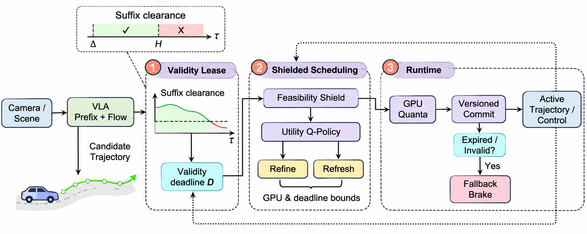
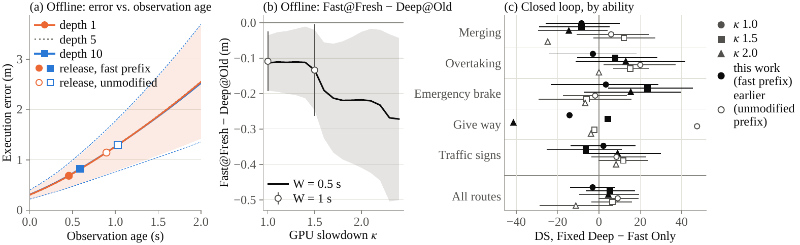
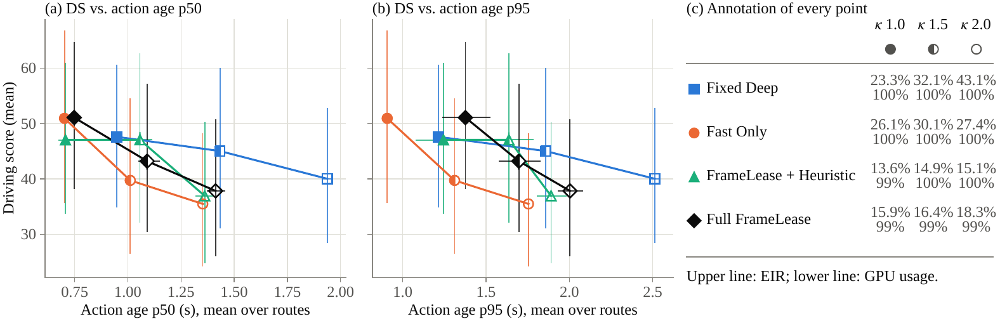

# 🚗 FrameLease: Action-Validity-Aware Compute Scheduling for Real-Time Autonomous Driving

We present **FrameLease**, a runtime scheduler for deep-reasoning driving VLA models that decides, at every GPU quantum
boundary, whether to refine the current trajectory or refresh the observation. It turns the validity of each candidate
trajectory into a compute deadline (action-conditioned, suffix-aligned validity lease), admits only operations whose
p99-bounded completion precedes that deadline (feasibility shield), ranks the admitted operations with an offline-trained
CPU Q-network, and commits only unexpired, uncancelled, non-regressive candidates (versioned commit, cooperative
preemption, watchdog fallback).

<div align="center">

</div>

---

## News

* **`Nov. 19th, 2026`:** All 632 registered test runs are final; the second analysis freeze and the registered analysis
  are released.
* **`Nov. 18th, 2026`:** Code, registered protocol (Amendments A1-A17) and the frozen cut analysis on 14 test routes are released.

## Updates

- [X] Release code, registered protocol and job files
- [X] Release the registered analysis of all 632 test runs
- [ ] Release the paper
- [ ] Release raw closed-loop run directories (logs of every run)

## 📊 1. Results

Closed-loop Bench2Drive (CARLA 0.9.15), UniDriveVLA Stage-3 (2B, bf16), one RTX 4090 D, 44 held-out test routes,
GPU budget κ = 1, seed 11. All methods share the same checkpoint, fast prefix, runtime and fallback controller.

|         Method         | DS ↑ [95% CI] |   ΔDS (Full − method)   | SR % ↑ | Coll./km ↓ | DMR % ↓ | FB % ↓ | EIR % ↓ |
| :--------------------: | :-----------: | :---------------------: | :----: | :--------: | :-----: | :----: | :-----: |
|       Fixed Deep       | 50.4 [41.4, 59.5] |  +5.0 [−4.6, +14.5]  |  15.9  |   14.80    |   0.0   |  2.1   |  22.36  |
|       Fast Only        | 53.5 [43.7, 63.5] |  +1.9 [−8.9, +12.4]  |  20.5  |   13.69    |   0.0   |  1.8   |  24.86  |
|        Age-Only        | 52.6 [42.8, 62.8] |  +2.8 [−7.3, +12.7]  |  20.5  |   12.20    |   0.3   |  1.9   |  28.71  |
|    Event-Triggered     | 51.0 [42.4, 59.8] |  +4.4 [−5.0, +14.2]  |  13.6  |   11.90    |   0.0   |  1.6   |  24.81  |
| Original FrameLease †  | 25.9 [17.9, 34.5] | +29.6 [+19.1, +40.4] |  2.3   |    4.48    |  81.3   |  81.5  |  6.05   |
| FrameLease + Heuristic | 47.7 [38.2, 57.3] |  +7.7 [−0.4, +15.4]  |  13.6  |    7.85    |  41.8   |  42.8  |  11.46  |
|  **Full FrameLease**   | **55.3 [46.1, 64.8]** |        ref.          |  20.5  |    8.01    |  38.4   |  39.5  |  10.70  |

*† 43 routes (one simulator failure).*

> **Legend**
> • DS: Driving Score (Bench2Drive), mean with 95% route-bootstrap interval
> • ΔDS: paired route difference, Full FrameLease minus the method
> • SR: success rate • Coll./km: collisions per km, pooled over routes
> • DMR: control ticks with a missed plan-update deadline • FB: ticks in fallback braking
> • EIR: executed-invalid tick rate

**Registered outcomes** (pre-specified tests, Holm correction per family):

* H1, Full FrameLease vs. the four baselines: all inconclusive (p_Holm = 1.000). FrameLease has the highest mean DS, but
  the difference is not significant at 44 routes.
* H2, vs. FrameLease + Heuristic: inconclusive (p = 0.067). H3, vs. Original FrameLease: improves (p_Holm < 0.001).
* Collisions per km: per-route contrasts inconclusive. Deadline-miss rate: significantly worse than every baseline.
* GPU-budget sweep (κ = 1.5, 2), offline and closed-loop lease ablations, RL ablations: all inconclusive.
* Runtime (H5): 0 violations of the commit rule in 164,214 audited commits from 1,053 logged runs; labelled
  *contradicted* because 2 of 1,055 runs have no logs and could not be audited.

Full tables: [`outputs/framelease_v4/analysis/final_20261119T033942/figures/`](outputs/framelease_v4/analysis/final_20261119T033942/figures)
(`table1.tex`, `table2a.tex`, `table2b.tex`; every number in `numbers.json`).

---

## 📦 2. Repository Structure

```bash
FrameLease/
├── assets/                       # figures used in this README
├── framelease_v4/                # method, arms, runtime, RL pipeline, protocol tools, analysis code, tests
│   └── PROTOCOL.md               # pre-registered protocol and its dated amendments (A1-A18)
├── framelease_v2/, framelease_v3/  # earlier stages reused by v4 (queue runner, geometry, fast prefix, runtime)
├── framelease_common.py, stage02_real_vla.py, stage05_carla_closed_loop.py   # closed-loop launcher modules
├── linux/                        # environment setup, CARLA start script, dependency patches
├── configs/                      # requirement lists (requirements_lock_linux.txt: exact Python packages)
├── scripts/                      # verify_registration.sh, check_protocol_citations.py
├── docs/EXTERNAL_FILES.md        # registered files not in this repository (weights, third-party code)
└── outputs/framelease_v4/
    ├── registration/             # registration manifest (221 files) and seal
    ├── p1_jobs/, p2_jobs/, test_jobs/   # registered job files
    ├── tuning/, rl_freeze/, stress/, offline_ablation/, envelopes/   # tuning selection, RL freeze, stress tests
    ├── analysis/final_20261119T033942/   # second analysis freeze: all 632 test runs (this release)
    ├── analysis/final_20261116T091445/   # first (cut) analysis freeze: 14 test routes
    ├── verification_20261119T033942/     # independent recomputation for the second freeze
    └── amendment_*/, build/              # amendment application records and appliers
```

---

## ⚙️ 3. Installation

Environment of the experiment: Ubuntu 26.04, NVIDIA RTX 4090 D (driver 595.99), CUDA 12.4, Python 3.10.22,
PyTorch 2.5.1+cu124, CARLA 0.9.15, Bench2Drive, UniDriveVLA
([xiaomi-research/unidrivevla](https://github.com/xiaomi-research/unidrivevla), commit `a93c175`) with the checkpoint
`UniDriveVLA_Stage3_Bench2drive_2B.pt`.

```bash
# the registered modules use absolute paths: place (or link) the checkout at /home/kang/Desktop/DAC
git clone https://github.com/kang4u/FrameLease.git /home/kang/Desktop/DAC
cd /home/kang/Desktop/DAC
conda create -p .conda-unidrive-linux python=3.10
conda activate ./.conda-unidrive-linux
pip install -r configs/requirements_lock_linux.txt
bash linux/install_model_dependencies.sh
bash linux/apply_dependency_fixes.sh
source linux/env.sh
```

Model weights and unmodified third-party files are not included; [`docs/EXTERNAL_FILES.md`](docs/EXTERNAL_FILES.md)
lists each with its sha256. CARLA 0.9.15 is expected at `/home/kang/opt/CARLA_0.9.15` (`linux/start_carla.sh`).

---

## 🚀 4. Verification & Reproduction

Check every registered file in the repository against the registration manifest and the protocol seal:

```bash
bash scripts/verify_registration.sh
```

Recompute the registered analysis from the released aggregations (CPU only, about 10 s; the output is byte-identical to
`analysis/final_20261119T033942/analysis/`):

```bash
F=outputs/framelease_v4/analysis/final_20261119T033942
python -I -B framelease_v4/analysis/analyze_v4.py --agg $F/agg_p4 --agg $F/agg_p1 --agg $F/agg_p2 \
  --analysis-freeze $F/analysis_freeze.json --required-job-files $F/required_job_files.json \
  --rl-freeze outputs/framelease_v4/rl_freeze/rl_freeze.json --offline outputs/framelease_v4/offline_ablation \
  --s3 outputs/framelease_v4/stress/s3_registered_20261115T122819Z.json --out /tmp/framelease_analysis
```

Run closed-loop jobs (needs CARLA, the checkpoint and the GPU): a queue directory with job files in `jobs.d/` is started by

```bash
bash framelease_v4/protocol/launch_queue.sh <queue_dir>
```

The registered test jobs are in `outputs/framelease_v4/test_jobs/FULL/` (632 jobs); the experiment phases, gates and
decision rules are specified in `framelease_v4/PROTOCOL.md`.

---

## 🔍 5. Quality–Freshness Trade-off

<div align="center">
  
</div>
<p align="left">
(a) Execution error against observation age for refinement depths 1, 5 and 10 on 15 held-out clips. (b) Fresh depth-1
minus stale depth-10 error under GPU contention κ. (c) Closed-loop DS difference Fixed Deep − Fast Only by Bench2Drive ability.

## 🔍 6. Driving Score under Constrained GPU Budgets

<div align="center">
  
</div>
<p align="left">
Mean DS against action-age p50 (a) and p95 (b) on subset E (22 test routes) at κ = 1, 1.5 and 2; (c) EIR and GPU usage of every point.

## Acknowledgement

FrameLease builds on the following open-source projects: [UniDriveVLA](https://github.com/xiaomi-research/unidrivevla),
[Bench2Drive](https://github.com/Thinklab-SJTU/Bench2Drive), [CARLA](https://github.com/carla-simulator/carla).

## License

MIT ([`LICENSE`](LICENSE)). Third-party code and model weights keep their own licenses.

## Citation

If you find FrameLease useful in your research or applications, please consider giving us a star 🌟 and citing it by the
following BibTeX entry.

```bibtex
@article{framelease2026,
  title  = {FrameLease: Action-Validity-Aware Compute Scheduling for Real-Time Autonomous Driving},
  year   = {2026},
  note   = {update soon}
}
```
